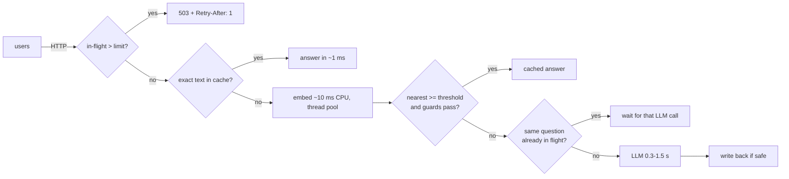

# Load test

> **Synthetic numbers.** These were measured on a 2-vCPU / 7 GB cloud VM with **fake backends**
> (fake LLM with 300-1500 ms latency, fake embedder burning ~10 ms of CPU per call). The load
> generator ran **on the same machine** as the server. They show where the design breaks
> and which fixes help. They are not a capacity number for production hardware.

## Setup

- Server: `uvicorn --factory semcache.api:create_app`, 1 process, FAISS store, 30 seeded FAQs.
- Fake LLM latency uniform 0.3-1.5 s (a typical small hosted model); fake embedding ~10 ms of
  CPU that **holds the GIL** (spin-wait, not `sleep`), like a MiniLM forward pass on CPU.
- Users: closed loop, 0.5-2 s think time, questions drawn from a Zipf distribution over 200
  questions (a few questions are very popular, like real support traffic).
- Stages: 50 → 500 → 1,000 → 2,000 → 5,000 users; 5 s ramp + 20 s steady state each; a fresh
  server (empty write-back cache) for every stage.
- Reproduce: `make loadtest` (or `python loadtest/run_load.py --label NAME --env KEY=VALUE`).
  Raw results: `reports/loadtest/*.json`.

## Request flow under load

## Before the fixes (`baseline`, commit `c286627`)

| Users | Requests | RPS | p50 ms | p95 ms | p99 ms | Errors | Hit rate | LLM calls | Server CPU avg/max % |
|---|---|---|---|---|---|---|---|---|---|
| 50 | 845 | 31.4 | 22 | 1,033 | 1,417 | 0.0% | 0.90 | 88 | 50/78 |
| 500 | 1,893 | **56.8** | **4,770** | 12,664 | 15,183 | 0.2% | 0.91 | 164 | 74/112 |
| 1,000 | 2,085 | 50.9 | 10,408 | 28,372 | 31,438 | 0.1% | 0.91 | 193 | 67/110 |
| 2,000 | 3,158 | 54.3 | 21,022 | 46,819 | 51,361 | 0.1% | 0.94 | 206 | 72/122 |
| 5,000 | 6,125 | 67.1 | 47,386 | 65,063 | 66,195 | **18.3%** (connect timeouts) | 0.95 | 278 | 71/111 |

### What broke first, and why

1. **Throughput hit a ceiling of ~55 RPS at 500 users and never went higher.** Every request,
   *even an exact repeat that is already cached*, paid for an embedding. Embedding is CPU-bound
   and holds the GIL, so a single Python process does roughly 1 / 10 ms = 100 embeddings per
   second at best. With the event loop also needing the GIL, it settled around 55. After that,
   requests simply queued: p50 went from 22 ms to 4.8 s, then 47 s.
2. **Cache stampede.** When a popular question is not cached yet, every user asking it at the
   same moment misses and calls the LLM. At 5,000 users there were 278 LLM calls for roughly
   200 distinct questions. The extra calls are duplicate work, and with a paid API, duplicate cost.
3. **At 5,000 users the server stopped accepting connections in time** (1,061 connect timeouts).
   The event loop was too busy to `accept()` new sockets, so the kernel backlog filled up.
4. Memory was not the problem: RSS stayed between 100 and 190 MB thanks to the LRU and tenant caps.

## Fixes (each one tested, see `tests/unit/test_scaling_fixes.py`)

| Fix | Why | Setting |
|---|---|---|
| **Exact-match fast path**: an O(1) dict lookup on normalised text *before* embedding | With Zipf traffic most requests are exact repeats; they no longer touch the model | `EXACT_FAST_PATH=true` (default) |
| **Single-flight**: concurrent identical misses wait for one LLM call | Kills the stampede; LLM calls ≈ distinct questions | `SINGLE_FLIGHT=true` (default) |
| **Load shedding**: above N in-flight requests, answer `503 Retry-After: 1` immediately | Fail fast instead of making everyone wait 60 s | `MAX_INFLIGHT_REQUESTS=256` |

## After the fixes (`tuned`)

| Users | Requests | RPS | p50 ms | p95 ms | p99 ms | Errors | Hit rate | LLM calls | Server CPU avg/max % |
|---|---|---|---|---|---|---|---|---|---|
| 50 | 860 | 31.0 | **6** | 933 | 1,399 | 0.0% | 0.90 | 74 | 23/44 |
| 500 | 4,479 | **158.4** | **970** | 4,155 | 6,170 | 0.0% | 0.96 | **112** | 63/124 |
| 1,000 | 3,452 | 116.7 | 3,810 | 16,155 | 20,969 | 0.0% | 0.93 | 117 | 53/104 |
| 2,000 | 3,740 | 99.5 | 11,253 | 26,271 | 29,561 | 4.1% (503 shed) | 0.93 | 114 | 48/99 |
| 5,000 | 6,280 | 74.7 | 18,241 | 24,469 | 25,229 | 49.4% (608 shed, 2,491 connect timeouts) | 0.91 | 118 | 38/97 |

**What changed**
- At 500 users: **2.8x the throughput** (57 → 158 RPS) and **p50 down 4.9x** (4.8 s → 0.97 s),
  with zero errors.
- LLM calls stayed flat at ~115 across all stages (the stampede is gone): **-57% LLM calls at
  5,000 users** (278 → 118).
- p99 at 5,000 users fell from 66 s to 25 s; the server now says "busy" instead of hanging.
- Median latency at 50 users fell from 22 ms to 6 ms because repeats skip the model entirely.

### What still breaks above ~1,000 users, and an honest caveat

I measured the load generator itself: at 1,000 and 2,000 users it used **80-83% of a CPU
core** (a single-threaded event loop is close to its limit there), while the server used only
43-59% (`reports/loadtest/tuned-cpu-check.json`). Above ~1,000 users this VM measures the load
generator as much as the server. The server-side limits that remain are real, though:

- **One Python process.** All cache hits still go through one event loop and the GIL.
- **The cache lives in process memory**, so adding uvicorn workers would split the cache
  (each worker would have its own and the hit rate would drop).

## Next steps for real scale

1. Move the cache to **Redis** (`RedisVL SemanticCache`, optional `[redis]` extra) so N worker
   processes / pods share one cache; then run `--workers = CPU count`.
2. **Batch embeddings**: a small queue that embeds up to 32 questions per forward pass (much
   higher throughput on CPU and GPU).
3. Run the embedding model as its own service (e.g. Text Embeddings Inference) and scale it
   separately from the API.
4. Load test from **separate machines** (distributed Locust) to get a true capacity number.
5. Per-tenant rate limits at the gateway, so one tenant cannot use up the shared capacity.
