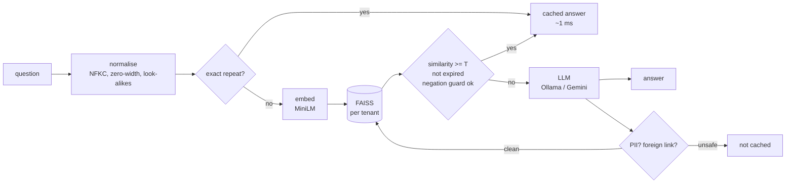

# semantic-cache-faq-bot

A semantic cache in front of an LLM support bot: if a new question **means** the same as one
already answered, return the saved answer in milliseconds instead of paying for another LLM
call. Measured with a hit rate, a false-hit count and latency on a labelled English + Hinglish
test set.

<!-- HEADLINE:START -->
**Not yet run with real models: run `make experiments` (see Quickstart).**
<!-- HEADLINE:END -->


## Architecture



## How it works

1. **Normalise** the question: Unicode NFKC, strip invisible characters, unify apostrophes.
2. **Exact repeat?** An O(1) dictionary lookup. Popular questions never touch the model.
3. **Embed** with sentence-transformers (`paraphrase-multilingual-MiniLM-L12-v2` handles
   Hinglish). Vectors are L2-normalised, so a dot product is the cosine similarity.
4. **Search** that tenant's FAISS index for the 3 nearest cached questions, best first. A
   candidate is a **hit** only if its similarity is at or above the threshold, it hasn't
   expired, and the **negation guard** agrees ("refund milega" ≠ "refund nahi milega").
5. On a **miss**, call the LLM, return its answer, and **write it back** to the cache, unless
   it contains user data (order ID, phone, email, "my name is…") or a link outside the
   allowlist.
6. Every request is logged as one JSON line: question hash, hit/miss, similarity, latency, tokens.
7. **Invalidation:** when a policy changes, `DELETE /cache/{tenant}?source_id=f11` (admin
   token) purges that FAQ's cached answers immediately instead of waiting for the TTL;
   `?generated_only=true` purges only LLM-written answers.
8. **Cost:** the experiment prices the measured tokens per 1,000 questions, before and after
   the cache (prices configurable in `.env`).

## Quickstart

```bash
python -m venv .venv && source .venv/bin/activate      # Windows: .venv\Scripts\activate
make install-models          # = pip install -e ".[dev,models]"
cp .env.example .env
```

**Option A, Ollama (free, offline):** install from https://ollama.com, then
```bash
ollama pull qwen2.5:3b       # .env: LLM_PROVIDER=ollama
```
**Option B, Gemini (free tier):** put your key from https://aistudio.google.com/apikey in
`.env` as `GEMINI_API_KEY=...` and set `LLM_PROVIDER=gemini`.

```bash
make test                    # 180+ tests, no network needed
make experiments             # real run: fills the results below (~5-10 min)
make demo                    # same question 3 ways: LLM, then cache, then cache
make serve                   # http://localhost:8000/docs
make loadtest                # optional, ~5 min
```

**Live demo page:** `make serve` and open http://localhost:8000. **Deploy:** the `Dockerfile`
runs on Hugging Face Spaces (Docker SDK, set `PORT=7860`), Render or Fly.io; use
`LLM_PROVIDER=gemini` with the key as a platform secret.

**Tracing:** set `TRACING=console` to print spans, or `TRACING=otlp` plus the standard
`OTEL_EXPORTER_OTLP_ENDPOINT` / `OTEL_EXPORTER_OTLP_HEADERS` to send them to Jaeger, Grafana
Tempo or Langfuse (`pip install -e ".[otel]"`). Each request is a `faq.ask` span with child
spans `cache.exact_lookup`, `embed`, `cache.lookup` and `llm.generate`, carrying tokens, USD
cost and latency, never the raw question. `/metrics` also reports total cost.

`make smoke` runs the whole pipeline with fake backends (no network); its output goes only to
`reports/smoke/` and is labelled as not a real measurement.

## Results

<!-- RESULTS:START -->
Not yet run with real models: run `make experiments`. This block, the headline above and
`reports/results.json` are written by `scripts/run_experiments.py`; nothing here is typed by hand.
<!-- RESULTS:END -->

## Design decisions and trade-offs

- **Semantic over exact-match caching.** Exact match misses "refund kab milega?" vs "When will
  I get my refund?". Embeddings catch paraphrases and code-mixed Hinglish. The price is false
  hits, so the threshold is chosen from a sweep on labelled data, not guessed.
- **How the threshold is chosen:** the highest recall on repeat questions with at most 1 false
  hit; ties go to the higher (safer) threshold. A false hit (a confidently wrong answer) costs
  more than a miss (a slower answer), so precision wins ties.
- **Exact-match layer in front.** Found by the load test: with real (Zipf) traffic most
  requests are exact repeats, and skipping the embedding made throughput 2.8x higher.
- **FAISS `IndexFlatIP` instead of Chroma.** In-process with no server, exact search, fast up to
  ~100k vectors, and `IndexIDMap2` allows deletes for TTL and LRU. Chroma adds persistence and
  metadata filtering that this cache doesn't need. For multiple processes the answer is Redis,
  not Chroma (see LOAD_TEST.md).
- **One index per tenant.** Isolation by construction: a bug in filtering cannot leak another
  tenant's answers.
- **Negation guard as a rule, not a model.** Simple, explainable, and measurable (the results
  show false hits with the guard on vs off). Cost: Hinglish "na" ("bata na") is also a filler
  word; two such questions are kept in the test set on purpose to measure that cost.
- **TTL by category.** Pricing answers expire after 1 day, policies after 7, general answers
  after 30. LLM-generated answers expire after 1 day because nobody reviewed them.
- **Read-only cache during evaluation**, so the order of test questions cannot change the result.
- **Async I/O, embedding in a thread.** The LLM call is I/O-bound (async); embedding is CPU-bound
  (`asyncio.to_thread`) so it doesn't block the event loop.

## Security

Full review with 30+ findings and their regression tests: [SECURITY.md](SECURITY.md). Highlights:
- **Cache poisoning through write-back** (a user makes the LLM emit a phishing link, which then
  gets served to everyone): blocked by a link-domain allowlist before caching.
- **PII** (order IDs, phones even when written as `9 8 7 6 5 …`, emails, names) is never cached.
- **Guard evasion** with zero-width characters and Cyrillic look-alikes: fixed with a
  confusables fold used only for matching.
- **Length-limit bypass with NFKC expansion** (one character → 18): the limit is checked after
  normalisation.

## Load test

[LOAD_TEST.md](LOAD_TEST.md): 50 → 5,000 simulated users on a 2-vCPU VM with fake backends.
The first bottleneck was the CPU-bound embedding on every request (~55 RPS ceiling), plus an
LLM stampede. After the exact-match fast path, single-flight and load shedding: at 500 users
57 → 158 RPS and p50 4.8 s → 0.97 s; LLM calls at 5,000 users 278 → 118.

## Limitations and future work

- 100 test questions is a small sample; the threshold is tuned and reported on the same set.
  Next: a held-out split and bootstrap confidence intervals.
- PII detection is regex-based; a bare name or an address gets through. Next: Presidio / NER.
- The cache lives in process memory. Next: Redis (RedisVL `SemanticCache`) for multiple workers.
- No auth or rate limiting on the API (it belongs in a gateway).

## Interview talking points

- **Why semantic over exact-match caching:** paraphrases and Hinglish; exact match alone got
  only the literal repeats. Both are used: exact first (cheap), semantic second.
- **The false-hit risk:** a wrong cached answer is served confidently and fast. That's why the
  threshold comes from a labelled sweep, the negation guard exists, and generated answers have
  a short TTL.
- **What changes at scale:** Redis as a shared cache, TTL and invalidation when a policy
  changes, a separate cache per customer/tenant, embedding as its own batched service,
  single-flight to stop stampedes.

**Likely follow-ups**
1. *"Why not just lower the threshold for more hits?"* Because the sweep shows false hits
   rising faster than recall below the chosen threshold; each false hit is a wrong answer
   given to a customer.
2. *"How do you invalidate when the refund policy changes?"* Category TTLs bound how stale an
   answer can get; for an immediate change, `DELETE /cache/{tenant}?source_id=f11` purges every
   cached answer derived from that FAQ (the id is stored on each seeded entry).
3. *"What if two tenants share an FAQ?"* They still get separate indexes; the seed step simply
   loads it into both. Sharing an index would save memory but risk leaks.

## Project layout

```
src/semcache/   api, bot, cache, store (FAISS / numpy), guards, pii, links, text,
                embeddings, llm (Ollama / Gemini / Fake), experiments, config
tests/          unit/ integration/ security/   (98% coverage)
data/           faqs.jsonl (30), test_set.jsonl (100 labelled)
scripts/        run_experiments.py, demo.py
loadtest/       run_load.py
reports/        results (generated), smoke/, loadtest/
```

MIT licensed.
